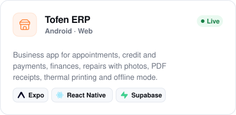
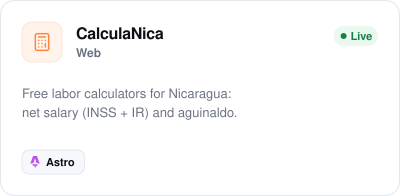
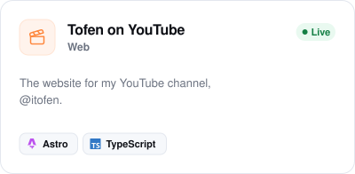
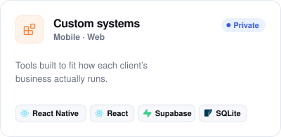
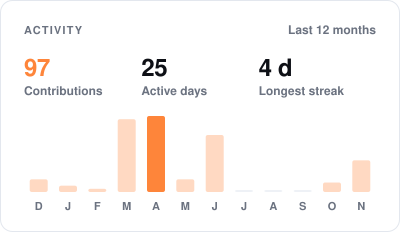
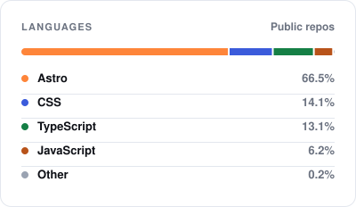
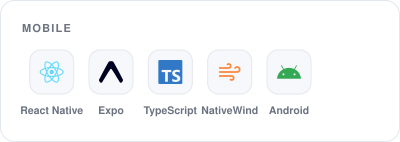
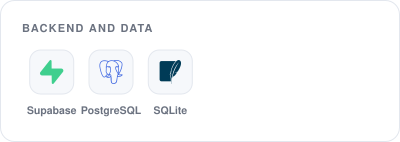
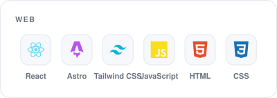
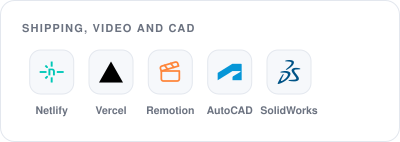

<picture>
  <source media="(prefers-color-scheme: dark)" srcset="assets/logo-dark.svg">
  
</picture>

### I build apps and custom systems for small businesses.

From CNC machining to software, with the same precision. Based in Nicaragua.

<picture>
  <source media="(prefers-color-scheme: dark)" srcset="assets/tagline-dark.svg">
  
</picture>

  

<a href="https://tofenportfolio.netlify.app/"><picture><source media="(prefers-color-scheme: dark)" srcset="assets/buttons/portfolio-dark.svg"></picture></a>
<a href="https://www.youtube.com/@itofen"><picture><source media="(prefers-color-scheme: dark)" srcset="assets/buttons/youtube-dark.svg"></picture></a>
<a href="https://www.linkedin.com/in/kevin-martinez-310bb73a2/"><picture><source media="(prefers-color-scheme: dark)" srcset="assets/buttons/linkedin-dark.svg"></picture></a>
<a href="https://discordapp.com/users/Tofen"><picture><source media="(prefers-color-scheme: dark)" srcset="assets/buttons/discord-dark.svg"></picture></a>
<a href="mailto:richtofenmartinez200@gmail.com"><picture><source media="(prefers-color-scheme: dark)" srcset="assets/buttons/email-dark.svg"></picture></a>

<i>Determination carries success.</i>

 

##  What I've built

  <a href="https://tofenerp-landing.netlify.app"><picture><source media="(prefers-color-scheme: dark)" srcset="assets/projects/tofen-erp-dark.svg"></picture></a>
  <a href="https://calculanica.netlify.app"><picture><source media="(prefers-color-scheme: dark)" srcset="assets/projects/calculanica-dark.svg"></picture></a>
  <a href="https://tofen-youtube-page.vercel.app"><picture><source media="(prefers-color-scheme: dark)" srcset="assets/projects/youtube-site-dark.svg"></picture></a>
  <picture><source media="(prefers-color-scheme: dark)" srcset="assets/projects/custom-systems-dark.svg"></picture>

Try Tofen ERP in your browser: <a href="https://tofenerp.netlify.app">tofenerp.netlify.app</a>

 

##  Activity

  <picture>
    <source media="(prefers-color-scheme: dark)" srcset="assets/activity-dark.svg">
    
  </picture>
  <picture>
    <source media="(prefers-color-scheme: dark)" srcset="assets/languages-dark.svg">
    
  </picture>

 

##  Stack

  <picture><source media="(prefers-color-scheme: dark)" srcset="assets/stack/mobile-dark.svg"></picture>
  <picture><source media="(prefers-color-scheme: dark)" srcset="assets/stack/backend-dark.svg"></picture>
  <picture><source media="(prefers-color-scheme: dark)" srcset="assets/stack/web-dark.svg"></picture>
  <picture><source media="(prefers-color-scheme: dark)" srcset="assets/stack/more-dark.svg"></picture>

